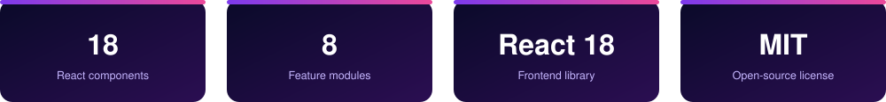
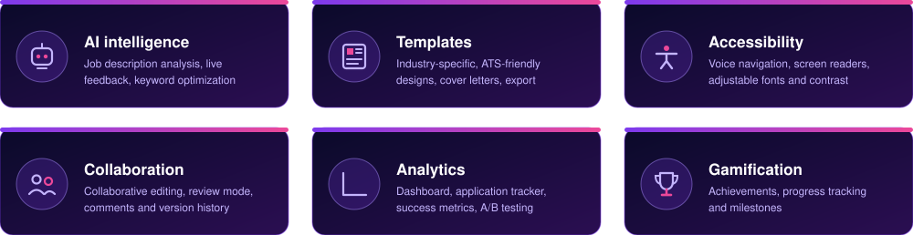
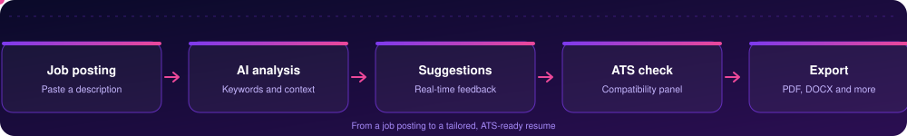

<div align="center">



<br>


**Create tailored, ATS-friendly resumes with AI suggestions, templates and a built-in application tracker.**

[Overview](#overview) · [Features](#features) · [How it works](#how-it-works) · [Quick start](#quick-start) · [Usage](#usage-examples) · [Structure](#project-structure) · [Contributing](#contributing) · [Author](#author)

[Live demo](https://tass027.github.io/ai-resume-builder) · [Report a bug](https://github.com/tass027/ai-resume-builder/issues) · [Request a feature](https://github.com/tass027/ai-resume-builder/issues/new)

</div>

---

## Overview

AI Resume Builder is a React application that helps job seekers write resumes that match the position they apply for. It analyzes a job description, suggests improvements while you write, checks ATS compatibility, and exports the result.

**Problem.** Tailoring a resume to each job posting is slow, and many resumes are filtered out by Applicant Tracking Systems before a human reads them.

**Solution.** An assistant that analyzes the job description, optimizes keywords, gives live feedback and keeps your applications organized in one place.

<div align="center">



</div>

## Features

<div align="center">



</div>

| Area | What you get |
|---|---|
| AI intelligence | Smart job description analysis, a real-time AI assistant with context-aware suggestions, instant quality feedback, automatic ATS keyword matching. |
| Templates | Industry-specific designs (tech, business, creative and more) optimized for ATS, a cover letter generator that matches your resume, export to PDF, DOCX and more. |
| Accessibility | Voice navigation for hands-free building, screen reader support, adjustable fonts, colors and contrast, keyboard shortcuts. |
| Collaboration | Collaborative editing, review mode for colleagues and mentors, comments directly on the resume, version history. |
| Analytics and tracking | Dashboard for views, downloads and engagement, application tracker, success metrics, A/B testing of resume versions. |
| Gamification | Achievements and rewards, progress tracking, milestones, optional leaderboards. |

## How it works

<div align="center">



</div>

1. Paste the **job description** of the position you target.
2. The **analyzer** extracts the keywords and context that matter.
3. **Smart suggestions** and live feedback guide your writing.
4. The **ATS panel** checks that your resume stays compatible.
5. **Export** the final version, with a matching cover letter if you want one.

### Technology stack

| Area | Technologies |
|---|---|
| Frontend | React 18.2, JavaScript (ES6+), CSS3, HTML5 |
| Data | Local data files for templates, themes and translations (i18n) |
| Tools | Git, GitHub, VS Code, npm |

## Quick start

**Prerequisites**

- Node.js 16 or higher
- npm 8 or higher
- Git 2 or higher

```bash
# Clone the repository
git clone https://github.com/tass027/ai-resume-builder.git
cd ai-resume-builder

# Install dependencies
npm install

# Start the development server
npm start
```

Then open [http://localhost:3000](http://localhost:3000).

### Available scripts

| Command | Description |
|---|---|
| `npm start` | Run the development server |
| `npm run build` | Create a production build |
| `npm test` | Run the test suite |
| `npm run deploy` | Deploy to production |

## Usage examples

### AI-powered job analysis

```javascript
import JobDescriptionAnalyzer from './components/ai/JobDescriptionAnalyzer';

<JobDescriptionAnalyzer
  onAnalysisComplete={(keywords) => {
    console.log('Optimized keywords:', keywords);
  }}
/>
```

### Voice navigation

```javascript
import VoiceRecognition from './components/accessibility/VoiceRecognition';

<VoiceRecognition enabled={true} />
```

## Project structure

```
ai-resume-builder/
├── public/
│   └── index.html
├── src/
│   ├── components/
│   │   ├── ai/                   # JobDescriptionAnalyzer, LiveFeedback, RealAIAssistant
│   │   ├── accessibility/        # AccessibilitySettings, VoiceRecognition
│   │   ├── analytics/            # AnalyticsDashboard
│   │   ├── collaboration/        # CollaborativeEditor
│   │   ├── gamification/         # AchievementsSystem
│   │   ├── plugins/              # PluginManager
│   │   ├── presentation/         # PresentationMode
│   │   └── templates/            # ResumePreview, ATSAnalysisPanel, CoverLetterGenerator,
│   │                             # ExportOptions, ApplicationTracker, SmartSuggestions,
│   │                             # EnhancedPhotoUpload, PhotoSettings
│   ├── data/
│   │   ├── templates.js          # Resume templates
│   │   ├── themes.js             # Color themes
│   │   └── translations.js       # i18n translations
│   ├── utils/
│   ├── App.js                    # Main application component
│   ├── App.css                   # Global styles
│   └── index.js                  # React entry point
├── assets/                       # README graphics
├── package.json
├── README.md
└── LICENSE.txt
```

## Contributing

Contributions are welcome.

1. Fork the repository.
2. Create a feature branch: `git checkout -b feature/your-feature`
3. Commit your changes: `git commit -m "Add your feature"`
4. Push the branch: `git push origin feature/your-feature`
5. Open a Pull Request.

Areas where help is welcome: internationalization (i18n), new resume templates, test coverage, documentation and bug fixes.

## License

Distributed under the MIT License. See the [LICENSE](LICENSE.txt) file.

## Author

**Tasnim Elmehrabi** · [GitHub](https://github.com/tass027) · [LinkedIn](https://www.linkedin.com/in/VOTRE-PROFIL)

## Acknowledgments

- [React](https://reactjs.org/) for the UI library
- [OpenAI](https://openai.com/) for AI technology inspiration
- The open-source community
